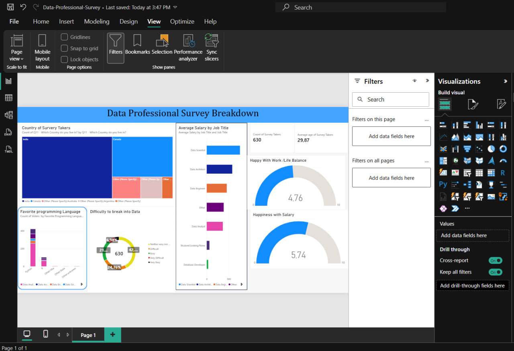

# Data Professional Survey Breakdown

## Project Overview

This project presents an interactive Power BI dashboard analyzing survey responses from 630 data professionals.

The dashboard explores different aspects of the data profession, including career roles, salaries, programming language preferences, job satisfaction, and work-life balance.

## Tools & Technologies

- Microsoft Power BI Desktop
- Power Query
- Data Visualization
- Data Cleaning and Transformation
- Interactive Dashboard Design

## Key Insights & Visualizations

The dashboard includes:

1. **Country of Survey Takers** – Distribution of respondents by country.
2. **Average Salary by Job Title** – Salary comparison across different data-related roles.
3. **Favorite Programming Language** – Most popular programming languages among respondents.
4. **Difficulty Breaking into Data** – Respondents' perceptions of entering the data industry.
5. **Happiness with Work-Life Balance** – Average satisfaction with work-life balance.
6. **Happiness with Salary** – Average salary satisfaction.
7. **Survey Statistics** – Total number of respondents and average age.

## Project Objectives

- Analyze survey data to identify trends in the data profession.
- Compare salaries across different job titles.
- Understand programming language preferences.
- Explore career challenges and job satisfaction.
- Present insights through an interactive dashboard.

## Dashboard Preview

## Author

**Arona Barry**

GitHub: [@Arona416](https://github.com/Arona416)

Portfolio: Data Analysis Projects
