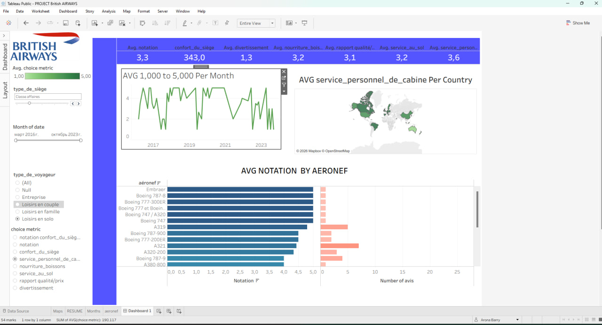

# British Airways – Customer Satisfaction Dashboard

## Project Overview

This project focuses on analyzing British Airways customer reviews and satisfaction data using Tableau Public.

The objective is to explore customer feedback, identify satisfaction trends, and understand the factors influencing the overall passenger experience.

## Tools & Technologies
- Tableau Public
- Data Visualization
- Data Analysis
- Calculated Fields
- Interactive Dashboards

## Dashboard Features

- Average customer rating analysis
- Seat comfort evaluation
- Cabin staff service performance
- Food and beverages satisfaction
- Entertainment ratings
- Value for money analysis
- Customer satisfaction by aircraft
- Geographic analysis of customer reviews
- Monthly customer rating trends

## Key Insights

The dashboard provides an interactive overview of passenger satisfaction across different service categories, aircraft types, and geographical regions.

Users can explore the results by selecting different metrics, passenger types, seat classes, and date ranges.

## Interactive Dashboard

The dashboard was developed using Tableau Public to facilitate dynamic exploration of customer satisfaction metrics.

## Project Files

- `British-Airways.twbx` – Packaged Tableau workbook.
- `british-airways-dashboard.png` – Dashboard preview.
- `README.md` – Project documentation.

## Author

**Arona Barry**

Data Analytics | Applied Computer Science

GitHub: [Arona416](https://github.com/Arona416)
